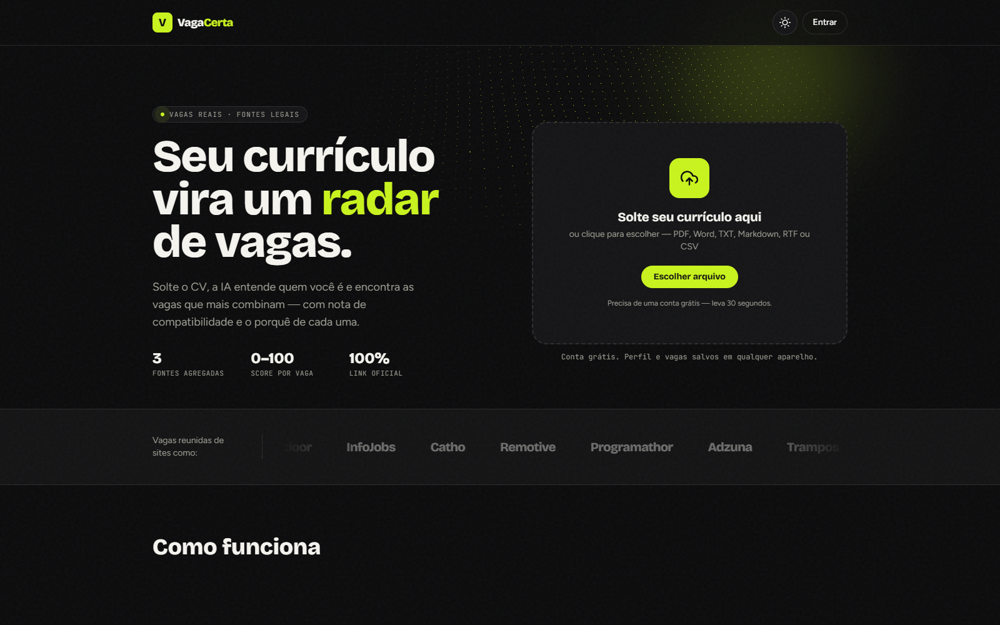
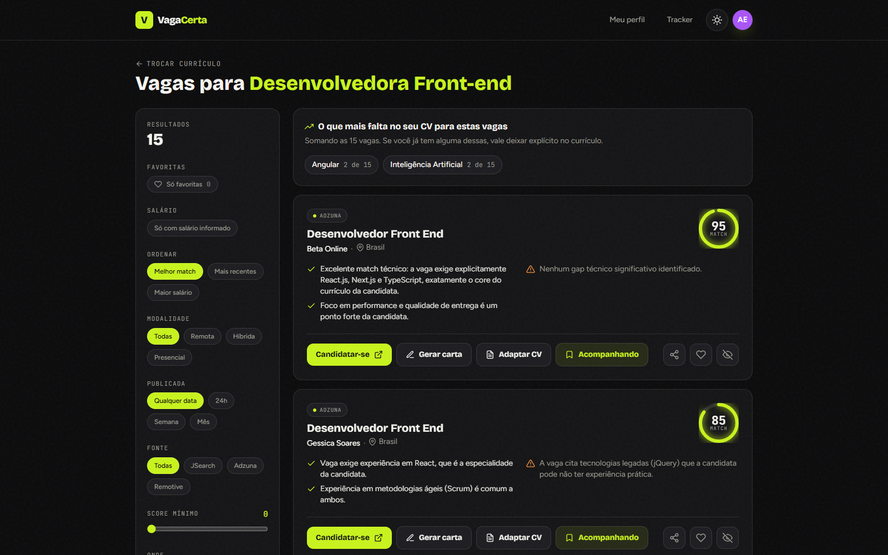
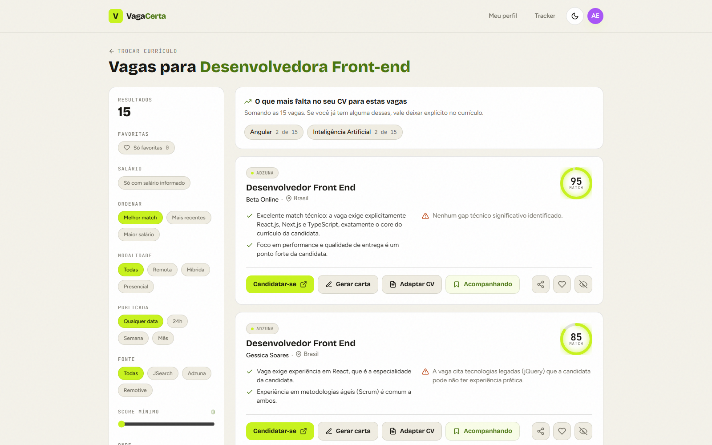
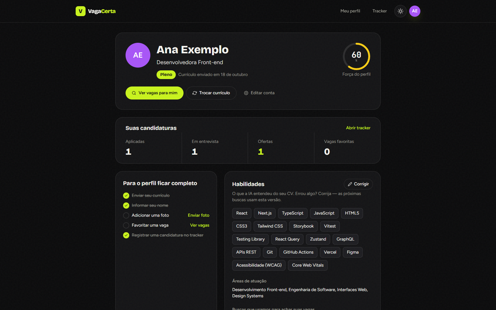
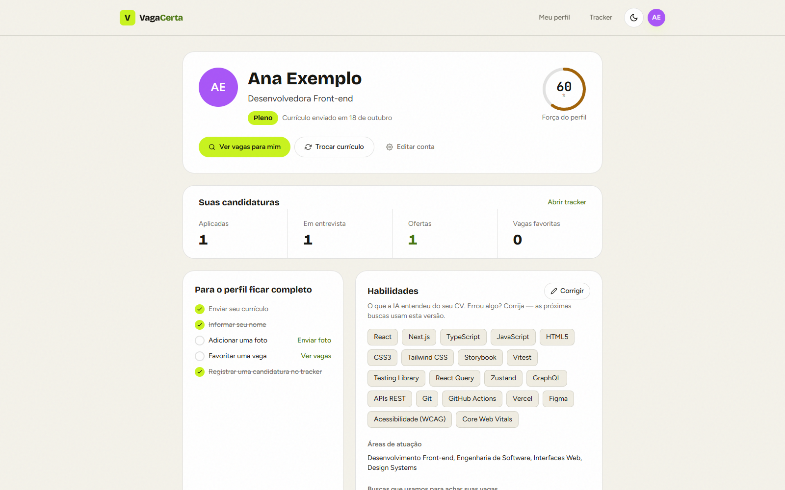
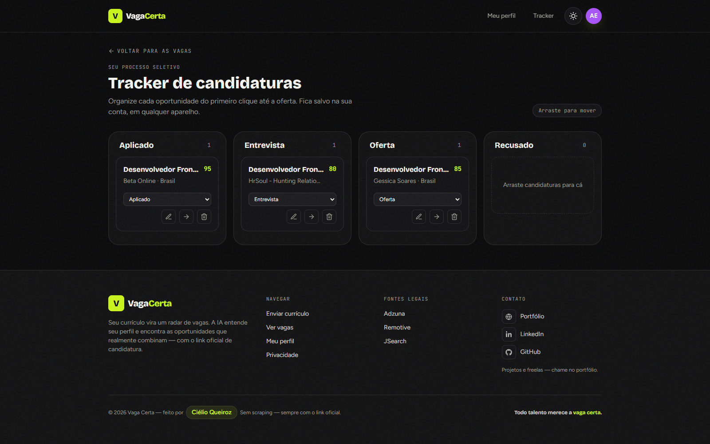
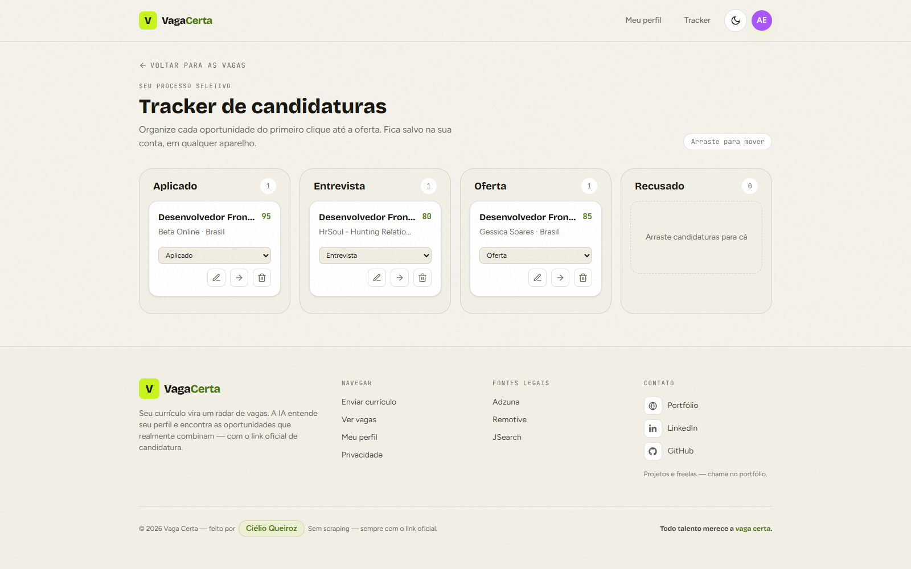
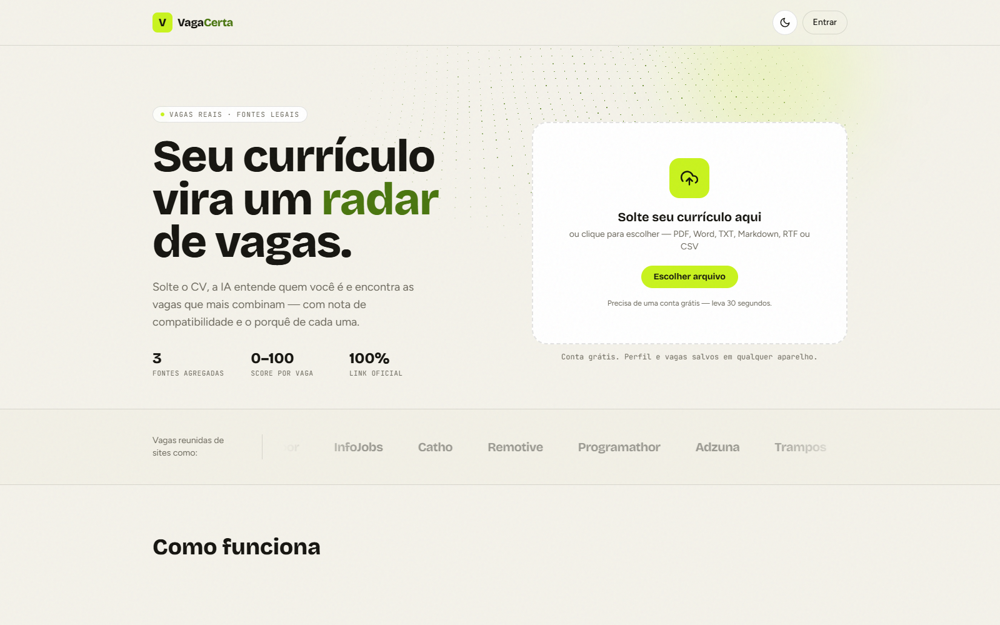

<div align="center">

# 🎯 Vaga Certa

### Seu currículo vira um radar de vagas.

Envie seu CV. A IA entende quem você é, busca **vagas reais** em fontes legais e pontua cada uma —
com os motivos a favor, o que falta no seu perfil e o **link oficial de candidatura**.

<br/>


<br/>

### [🚀 Ver funcionando →](https://vaga-certa-sooty.vercel.app)

<sub>Conta grátis. Suba um currículo e veja o score.</sub>

<br/>



</div>

<br/>

## O que ele faz

Você solta o currículo — **PDF, Word (.doc/.docx), TXT, Markdown, RTF ou CSV**. Em poucos segundos:

1. **A IA lê o CV** e extrai cargo, senioridade, habilidades e as melhores buscas para o seu perfil.
2. **Três fontes legais** são consultadas em paralelo — Adzuna, Remotive e JSearch.
3. **Cada vaga recebe uma nota de 0 a 100**, com os motivos a favor e as lacunas do seu CV.
4. **Se você quiser**, a IA escreve a **carta de apresentação** daquela vaga — no tom e no
   tamanho que você escolher, mostrando quais palavras-chave da vaga entraram no texto.
   Baixe em **PDF** ou **compartilhe** pelo menu do seu próprio celular.
5. Você vai direto ao **link oficial** — sem intermediário.
6. Em cada vaga, você pode **adaptar o CV** para destacar somente experiências reais relevantes.
7. Adicione oportunidades ao **tracker Kanban** — Aplicado → Entrevista → Oferta → Recusado —,
   com anotações e a data da entrevista.
8. No seu perfil, gere um relatório de **como melhorar o CV** com prioridades acionáveis.

E no dia a dia:

- **O que mais falta no seu CV** — as habilidades que as vagas pedem e o currículo não mostra,
  somadas na lista inteira.
- **Filtros** por modalidade, data, fonte, salário (com moeda e período certos) e nota mínima;
  e **"Onde"** refaz a busca por estado, cidade ou país.
- **"Não tenho interesse"** com motivo tira a vaga da lista (e das próximas buscas), com desfazer.
- **Vagas novas**: depois de uma nova busca, as vagas com nota 70+ que não estavam na anterior
  ganham o selo **Nova**, e o painel avisa quantas chegaram.
- **Perfil editável** — se a IA entendeu errado alguma habilidade, você corrige e as próximas
  buscas usam a sua versão.
- **Seus dados são seus** — exporte tudo em JSON ou exclua a conta em `/conta` (LGPD).

Para usar, basta **criar uma conta grátis** (e-mail e senha, ou Google). O perfil, o tracker,
os favoritos, as cartas e a foto ficam salvos na conta — em qualquer aparelho. Quem está logado
abre o site direto no painel do perfil.

> ⚖️ **Nada de scraping.** Só agregadores legais — e nós sempre levamos você ao anúncio original.

<br/>

## Como funciona

```mermaid
flowchart LR
    A[📄 CV<br/>PDF · Word · TXT · RTF · CSV] --> B[Extração de texto<br/><i>no servidor</i>]
    B --> C{{"🧠 Gemini<br/>analyzeCV"}}
    C --> D[["Perfil<br/>cargo · senioridade<br/>skills · buscas"]]
    D --> E[/"🔎 Busca em paralelo"/]
    E --> F1[Adzuna]
    E --> F2[Remotive]
    E --> F3[JSearch]
    F1 & F2 & F3 --> G[Normaliza + dedup]
    G --> H{{"🧠 Gemini<br/>matchJobs<br/><i>lote único</i>"}}
    H --> I[["🎯 Vagas ranqueadas<br/>score · motivos · lacunas"]]
    I -.-> J{{"✍️ Gemini<br/>generateCoverLetter<br/><i>só se você pedir</i>"}}
    J -.-> K[["📄 Carta da vaga<br/>tom · tamanho · ATS"]]
    K -.-> L[/"PDF · .txt · copiar · compartilhar"/]
    I -.-> M{{"🎯 Gemini<br/>adaptCV"}}
    M -.-> N[["CV direcionado<br/>resumo · skills · destaques"]]
    D -.-> O{{"🧠 Gemini<br/>generateCVImprovementReport"}}
    O -.-> P[["Relatório<br/>forças · lacunas · ações"]]
    I -.-> Q["📌 Tracker na conta<br/>Aplicado → Entrevista → Oferta → Recusado"]

    style C fill:#4285F4,stroke:#4285F4,color:#fff
    style H fill:#4285F4,stroke:#4285F4,color:#fff
    style I fill:#bef264,stroke:#84cc16,color:#000
    style A fill:#bef264,stroke:#84cc16,color:#000
    style M fill:#4285F4,stroke:#4285F4,color:#fff
    style O fill:#4285F4,stroke:#4285F4,color:#fff
    style Q fill:#bef264,stroke:#84cc16,color:#000
```



<br/>

## Telas

<sub>Prints com uma conta de demonstração e um currículo fictício.</sub>

<table>
<tr>
<td width="50%" align="center"><b>🌙 Escuro</b></td>
<td width="50%" align="center"><b>☀️ Claro</b></td>
</tr>
<tr>
<td></td>
<td></td>
</tr>
<tr>
<td colspan="2" align="center"><sub>Vagas ranqueadas: nota de match, o que combina (✓) e o que falta (⚠), o que mais falta no CV, filtros e o link oficial.</sub></td>
</tr>
<tr>
<td></td>
<td></td>
</tr>
<tr>
<td colspan="2" align="center"><sub>O painel: o perfil que a IA extraiu, as candidaturas em números, o que falta para o perfil ficar completo e as habilidades — editáveis.</sub></td>
</tr>
<tr>
<td></td>
<td></td>
</tr>
<tr>
<td colspan="2" align="center"><sub>O tracker: arraste os cards ou troque a etapa pelo seletor; anotações e data da entrevista em cada card.</sub></td>
</tr>
<tr>
<td></td>
<td></td>
</tr>
</table>

<br/>

## Novas ferramentas

### Adaptar o CV para uma vaga

Na lista de resultados, **Adaptar CV** gera um rascunho específico para aquela
posição: título, resumo, habilidades, realizações e palavras-chave. O prompt
proíbe inventar experiência, números ou tecnologias; lacunas aparecem como
cautelas para você revisar antes de enviar.

### Tracker de candidaturas

O botão **Acompanhar** salva a vaga no tracker, em `/candidaturas`. São quatro colunas —
Aplicado, Entrevista, Oferta e Recusado —, com arrastar e soltar ou o seletor de etapa (que
funciona no teclado). Cada card guarda anotações e a data da entrevista, e remover tem desfazer.
Tudo fica salvo na conta.

### Relatório de melhoria do CV

Em `/perfil`, o painel **Como melhorar seu CV** analisa o currículo atual e
retorna pontos fortes, melhorias priorizadas e termos para investigar. A IA é
instruída a diferenciar uma lacuna real de uma habilidade que não foi comprovada.

### Vagas novas, dentro do app

Não há busca em segundo plano — cada busca gasta cota da IA e das fontes. Então "nova" é a
vaga que apareceu na busca mais recente e não estava na anterior, com nota **70 ou mais**: ela
ganha o selo **Nova** em `/resultados`, e o painel do `/perfil` avisa quantas chegaram. Com a
lista a 3 dias ou mais, aparece o convite **Buscar vagas novas**.

Alertas **por e-mail** ficam para quando houver domínio próprio para o envio (Resend).

<br/>

## Decisões de projeto

Seis escolhas que definem o app, todas tomadas com medição — não com palpite.

### 1. Uma chamada para o lote inteiro, não uma por vaga

A primeira versão pontuava cada vaga numa requisição separada. Isso reenviava o **mesmo CV
15 vezes** e estourava o limite do free tier do Gemini (15 req/min) logo na primeira busca:

```
❌ antes:  1 (CV) + 15 (uma por vaga) = 16 requisições → HTTP 429
✅ agora:  1 (CV) + 1  (lote inteiro)  =  2 requisições → 3,8s
```

O `matchJobs` manda o CV uma vez e todas as vagas numeradas, e recebe um array de notas.
A IA responde por **índice**, nunca por `jobId` — índice é verificável, id é convite para alucinação.
A qualidade não mudou: os mesmos scores, o mesmo ranking.

### 2. `gemini-3.1-flash-lite`, medido contra o irmão maior

| | `gemini-3.5-flash` | `gemini-3.1-flash-lite` |
|---|---|---|
| Ler um CV | 16,0s | **1,5s** |
| Pontuar uma vaga | 23,2s | **3,2s** |
| Score (vaga aderente) | 88 | 85 |
| Score (fora da área) | 10 | 15 |
| Sob carga | 🔴 `503 high demand` | ✅ |

Mesmo ranking, mesma separação, **~10x mais rápido**. O modelo maior chegou a recusar
requisições por excesso de demanda.

### 3. A carta nunca é escrita sem você pedir

Havia um caminho fácil: gerar a carta junto com o score, ou no clique de "Candidatar-se".
Ele foi recusado.

Cada carta é uma chamada paga ao Gemini, e a maioria das vagas de uma lista **não** vira
candidatura. Gerar 15 cartas para o usuário ler duas é queimar cota dele e do app para
produzir texto que ninguém pediu. Então `Candidatar-se` continua sendo um link puro, sem
efeito colateral, e a carta só nasce de um clique explícito em **Gerar carta**.

O que se ganha com o clique:

| | |
|---|---|
| **Tom** | formal · entusiasmado · direto ao ponto |
| **Tamanho** | curta (~150 palavras) · média (~250) |
| **ATS** | os termos da vaga que a carta de fato usou, visíveis em chips |
| **Editável** | o texto na tela é o que vale — sua edição é o que é salva |
| **Saída** | salvar como **PDF** · baixar `.txt` · copiar · **compartilhar** pelo menu do sistema |

O prompt gasta mais linhas **proibindo** do que pedindo, porque um modelo solto escreve
exatamente a carta que recrutador descarta: proibidos o clichê ("sempre fui apaixonado
por…"), o currículo reescrito em prosa, e — o pior — inventar experiência que não está no
CV. Quando a vaga pede algo que falta, a carta reconhece com honestidade em vez de mentir.

A carta é salva por vaga na conta: reabrir não gasta outra chamada, em qualquer aparelho.

**O PDF usa a impressão nativa do navegador.** A carta tem uma folha A4 própria, e o botão
abre o diálogo para a pessoa escolher "Salvar como PDF". Assim o app não precisa manter uma
biblioteca adicional de geração de PDF no bundle ou no servidor.

**Word é aceito nos formatos `.doc` e `.docx`.** A leitura acontece no servidor diretamente
do Buffer, sem executar Word, LibreOffice ou binários externos. Todos os formatos têm limite
de tamanho; os formatos binários passam por validação de assinatura antes da extração.

**Compartilhar usa o menu do sistema, não uma fileira de botões de rede social.** A Web
Share API abre a lista que a pessoa realmente tem instalada (WhatsApp, e-mail, Telegram).
Onde não houver Web Share — a maioria dos desktops —, o conteúdo é copiado para a área de
transferência. Sempre sobra um caminho que funciona. Vale para a carta **e** para a vaga, e o
link compartilhado é sempre o anúncio oficial.

### 4. O schema zod é a fonte única da verdade

Não há JSON parseado na mão. O schema zod vira JSON Schema (`z.toJSONSchema`), a API é
instruída a responder naquele formato (`responseJsonSchema`), e a resposta **ainda passa pelo
zod** na volta. Se a IA fugir do contrato, estoura ali — não três camadas adiante.

### 5. As buscas da IA precisam ser curtas

Sites de emprego fazem busca **E**: todas as palavras precisam aparecer na vaga. A IA, sozinha,
gerava buscas descritivas e longas — que não retornavam nada:

| Busca gerada | Vagas encontradas |
|---|---:|
| `Desenvolvedora Front-end Pleno React TypeScript` | **1** |
| `front-end react` | **70** |

O prompt agora limita a 3 palavras e proíbe senioridade nas buscas. Parece um detalhe; é a
diferença entre o app achar vagas e não achar.

### 6. Página sem conteúdo público não vai para o índice

As áreas da conta (`/perfil`, `/resultados`, `/candidaturas`, `/conta`) exigem login — para um
robô, são só um redirecionamento. Ficam em `noindex` e bloqueadas no `robots.txt`: página vazia
indexada não deixa de ranquear, ela **puxa o site inteiro para baixo**.

O que o site expõe para máquinas: `robots.txt`, `sitemap.xml`, JSON-LD (`WebApplication` +
`FAQPage`), Open Graph com banner próprio, e um `llms.txt` para ChatGPT/Perplexity entenderem
e citarem o projeto.

### 7. O custo da IA tem freio por conta — e prazo

A IA é a parte paga do app, então ela tem três travas:

- **Limite por minuto** e **cota diária por conta** (10 análises de CV, 30 buscas pontuadas,
  20 cartas, 20 adaptações, 5 relatórios — renova à meia-noite de Brasília). A cota só é
  gasta quando a IA é chamada de fato.
- **Cache de notas** por versão do CV: a mesma vaga com o mesmo currículo não volta à IA por
  14 dias.
- **Orçamento de tempo**: retry com espera crescente quando o Gemini está sobrecarregado,
  mas tudo dentro de 50 s — nunca o 504 mudo da Vercel. Esgotou, a pessoa lê "A IA está com
  muita demanda agora", não "Falha".

### 8. Segurança e privacidade no servidor, não na promessa

- **RLS no Postgres**: as consultas de dados do usuário rodam numa role sem `BYPASSRLS`; uma
  consulta que esqueça o `where user_id` volta vazia, nunca com dado de outra pessoa.
- **A IA nunca lê o corpo da requisição**: perfil e vaga saem do banco — ninguém injeta texto
  no prompt editando o request.
- **Sessão revalidada**: senha trocada ou conta excluída derrubam os logins abertos.
- **Retenção de verdade**: um job diário faz o backup criptografado do banco e, depois dele,
  apaga notas vencidas, buscas antigas, tokens usados e contas sem acesso há 24 meses — o que
  a [política de privacidade](https://vaga-certa-sooty.vercel.app/privacidade) promete.

<br/>

## Arquitetura

Para a matriz de controles e os limites conhecidos, consulte [`SECURITY.md`](SECURITY.md).

```text
app/
  page.tsx                 landing + upload do CV
  resultados/              vagas com score, filtros, "Onde" e vagas novas
  perfil/                  painel: perfil, candidaturas, checklist, habilidades
  candidaturas/            tracker Kanban (na conta)
  conta/                   foto, nome, exportar dados e excluir conta
  entrar · cadastrar       login e cadastro (NextAuth v5, e-mail ou Google)
  esqueci-senha · redefinir-senha
  privacidade/             política de privacidade (LGPD)
  not-found.tsx            404 com caminho de volta
  api/
    auth/                  NextAuth + cadastro + reset de senha
    perfil/                avatar, conta, CV editado e exportação
    sync/                  tracker, favoritos, cartas, CVs adaptados, descartes e estado
    cv/analyze             extrai texto → Gemini devolve o CVProfile
    cv/adapt               adapta o CV para uma vaga específica
    cv/report              relatório de melhorias do CV
    jobs/search            busca nos providers (paralelo) → normaliza → dedup
    jobs/match             Gemini pontua CV × vagas, em lote único (com cache)
    cover-letter           Gemini escreve a carta de UMA vaga — só sob clique
lib/
  providers/               adapters isolados + agregador + fetch com timeout
    types.ts               schemas zod — o contrato de tudo
    adzuna · remotive · jsearch
  ai/gemini.ts             análise · matching · carta · adaptação · relatório (retry com prazo)
  jobs/                    busca, ranking, cache de notas, vagas novas e descartes no banco
  api/                     leitura limitada de JSON, guarda de origem, cota de IA, erro 503
  auth/                    usuários, senha, sessão, reset, avatar, perfil, sync e LGPD
  db/                      pool do Postgres (Neon) + escopo RLS por usuário
  cv/parser.ts             extração de texto (PDF · Word · TXT · Markdown · RTF · CSV)
  rate-limit.ts            limite por janela (Upstash, com queda para memória)
  client/                  estado do navegador, sync com a API, diálogos
  matching · filters · salary · skills-gap · region · share
db/migrations/             SQL fonte de verdade do schema (0001–0012)
.github/workflows/         CI (lint, tipos, testes, build, audit) e backup diário
components/                UI própria — sem kit genérico
```

Cada fonte de vaga é um **adapter** que implementa `JobProvider` e devolve o tipo `Job`
unificado. Adicionar uma fonte é criar um arquivo — nada mais no projeto muda.

**As rotas não confiam no cliente:** corpo validado com zod, teto de tamanho de arquivo
no servidor, limite por minuto e cota diária de IA por conta, e um teto de custo (quantas
vagas a IA pontua) separado do teto de payload (quantas o corpo aceita).

**Cota diária de IA por conta** (dia de calendário em Brasília, renova à meia-noite):
10 análises de CV, 30 buscas pontuadas, 20 cartas, 20 adaptações de CV e 5 relatórios.
A cota só é gasta quando a IA é de fato chamada — pedido inválido não consome.

<br/>

## Começar

```bash
git clone https://github.com/cielioqueiroz/buscador-de-cv.git
cd buscador-de-cv

npm install
cp .env.example .env.local   # preencha a GEMINI_API_KEY
npm run dev                  # http://localhost:3000
```

### Variáveis de ambiente

| Variável | Para quê | Onde obter | Obrigatória |
|---|---|---|:---:|
| `GEMINI_API_KEY` | Análise do CV e matching | [aistudio.google.com/apikey](https://aistudio.google.com/apikey) | ✅ |
| `ADZUNA_APP_ID` · `ADZUNA_APP_KEY` | Vagas no Brasil | [developer.adzuna.com](https://developer.adzuna.com) | recomendada |
| `RAPIDAPI_KEY` | JSearch | [rapidapi.com](https://rapidapi.com) → assine "JSearch" | recomendada |
| `UPSTASH_REDIS_REST_URL` · `UPSTASH_REDIS_REST_TOKEN` | Limites e cota de IA compartilhados entre instâncias (a integração da Vercel injeta `KV_REST_API_*`, também aceitas) | [upstash.com](https://upstash.com) (Redis grátis) | produção |
| `DATABASE_URL` | Contas e dados salvos (Postgres) | [neon.tech](https://neon.tech) → connection string *pooled* | para contas |
| `AUTH_SECRET` | Assina a sessão | `openssl rand -base64 32` | para contas |
| `AUTH_GOOGLE_ID` · `AUTH_GOOGLE_SECRET` | "Entrar com Google" | Google Cloud Console → OAuth client | opcional |
| `RESEND_API_KEY` · `EMAIL_FROM` | E-mail de redefinir senha | [resend.com](https://resend.com) + domínio verificado | opcional |

Só a do Gemini é **obrigatória** — sem ela o app não analisa o CV. As outras duas são gratuitas
e é delas que vêm as vagas brasileiras: o JSearch agrega **Indeed, Gupy, Catho, ProgramaThor,
Talent.com** e outros. Sem elas, sobra só o Remotive (público, mas só vagas remotas
internacionais).

Cada provider degrada com elegância — faltando uma chave, ele retorna vazio e os outros seguem
funcionando. O Upstash é opcional: sem ele, os limites usam um contador em memória por
instância; com ele, valem para o app inteiro (recomendado em produção, pois é o principal
freio da cota paga do Gemini).

O app exige conta para analisar o CV, buscar e pontuar vagas e gerar textos — as rotas de IA
devolvem 401 sem sessão. Com `DATABASE_URL` e `AUTH_SECRET`, o login por e-mail e senha
funciona. O botão do Google só aparece com as credenciais dele, e o "esqueci minha senha" só
aparece em produção com o Resend configurado. As migrations ficam em `db/migrations/`; `npm run db:migrate` aplica
as pendentes (registradas na tabela `schema_migrations`) e `npm run db:status` lista o estado.
Rode nos dois branches do Neon (main e preview).

> 🔒 As chaves ficam **só no servidor** (API Routes) — nunca chegam ao navegador.

<br/>

## Scripts

```bash
npm run dev        # desenvolvimento
npm run build      # build de produção
npm start          # serve o build
npm test           # testes unitários e de integração (Vitest)
npm run lint       # ESLint
npm run db:migrate # aplica as migrations pendentes
npm run db:status  # lista o estado das migrations
```

São **439 testes**: adapters, parser, agregador, guardas e limites das rotas, cota de IA,
retry com prazo do Gemini, matching em lote, cache de notas, vagas novas, RLS, sessão, LGPD,
tracker, componentes — e até o contraste das cores dos dois temas e a estrutura de
acessibilidade das páginas. As APIs externas são mockadas: **nenhum teste gasta chamada de IA.**

O CI roda lint, tipos, testes, build e `npm audit` a cada push; o deploy na Vercel sai do
`master`.

<br/>

## Roadmap

- [x] Contas — e-mail/senha ou Google, reset de senha, foto de perfil, painel e dados salvos no Neon
- [x] Excluir conta e exportar os dados — em `/conta`, com confirmação por e-mail e senha
- [x] Gerar carta de apresentação por vaga — tom, tamanho, ATS, editar, PDF, compartilhar
- [x] Adaptar o CV por vaga — rascunho direcionado, sem inventar experiência
- [x] Tracker de candidaturas — Kanban na conta, com anotações, data da entrevista e etapa Recusado
- [x] Relatório "como melhorar seu CV" — forças, prioridades e termos para investigar
- [x] Lacunas do CV, filtros de salário, descarte com motivo e perfil editável
- [x] Alerta de vagas novas no app — selo "Nova" e aviso no painel (nota 70+)
- [x] Cota diária de IA por conta e orçamento de tempo nas chamadas
- [x] Retenção — backup diário criptografado, limpeza de dados vencidos e contas inativas há 24 meses
- [x] Acessibilidade — "pular para o conteúdo", contraste AA nos dois temas, alvos de toque
- [ ] Alertas por e-mail de vagas novas (depende de domínio próprio para o Resend)
- [ ] Trocar o e-mail com verificação (idem)

<br/>

## Autor

Feito por **Ciélio Queiroz**.

Disponível para **projetos e freelas** — web, automação e soluções com IA.

[](https://cielio-portfolio.vercel.app)
[](https://www.linkedin.com/in/jacielio-queiroz/)
[](https://github.com/cielioqueiroz)

<br/>

## Licença

[MIT](LICENSE) — use, modifique, publique.

<div align="center">
<br/>
<sub><b>Todo talento merece a vaga certa.</b></sub>
</div>
